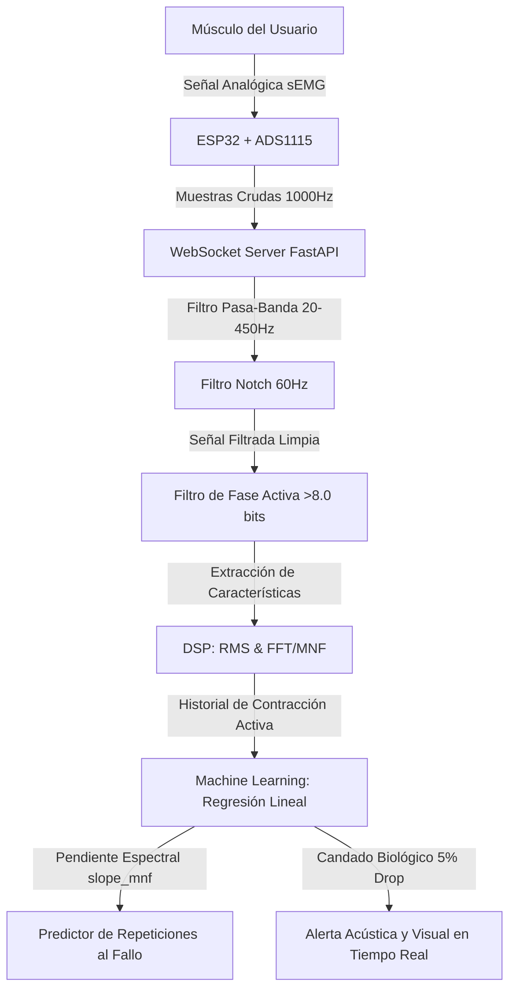

# Arquitectura de Machine Learning y DSP en el Ecosistema BioHevy sEMG

Este documento detalla la integración de **Procesamiento Digital de Señales (DSP)** y **Machine Learning (ML)** en tiempo real dentro del motor biomecánico de **BioHevy (EMG-Fit)**. Esta arquitectura está diseñada para convertir señales bioeléctricas analógicas crudas en predicciones de fatiga metabólica y estimación de repeticiones restantes hasta el fallo muscular.

---



---

## 1. Pipeline DSP y Extracción de Características (Feature Engineering)

Antes de alimentar cualquier modelo de Machine Learning, la señal cruda de sEMG de alta frecuencia ($f_s = 1000\text{ Hz}$) debe pasar por un pipeline DSP riguroso para eliminar el ruido y extraer las características físicas (features) fundamentales.

### A. Filtrado Digital
1. **Butterworth Pasa-Banda de 4to Orden ($20\text{ Hz} - 450\text{ Hz}$):** 
   Elimina los artefactos de movimiento físico (de baja frecuencia, $<20\text{ Hz}$) y el ruido de alta frecuencia del ambiente ($>450\text{ Hz}$).
2. **Filtro Notch IIR ($60\text{ Hz}$):** 
   Suprime quirúrgicamente el acople electromagnético de la red eléctrica de corriente alterna del hogar (hum de 60 Hz).

### B. Extracción de Características Biomecánicas
Cada ventana deslizante de 200 ms con 50% de solapamiento (overlap) extrae dos vectores de características clave:

* **RMS (Root Mean Square - Valor Cuadrático Medio):** 
  Mide la **amplitud** de la señal, la cual correlaciona directamente con el **reclutamiento de unidades motoras** y la fuerza generada.
  $$\text{RMS} = \sqrt{\frac{1}{N} \sum_{i=1}^{N} x_i^2}$$
  
* **MNF (Mean Frequency - Frecuencia Media Espectral):**
  Mide el **desplazamiento del espectro de potencia** mediante la Transformada Rápida de Fourier (FFT). Conforme el músculo se fatiga metabólicamente, la velocidad de conducción de los potenciales de acción disminuye debido al ácido láctico, causando que la MNF caiga de forma constante hacia frecuencias más bajas.
  $$\text{MNF} = \frac{\sum_{j=1}^{M} f_j \cdot P(f_j)}{\sum_{j=1}^{M} P(f_j)}$$
  *Donde $P(f_j)$ es la Densidad Espectral de Potencia en la frecuencia $f_j$.*

---

## 2. Modelos de Machine Learning Implementados

### A. Regresión Lineal Supervisada en Caliente (Supervised Linear Regression)
En el motor biomédico (`biomech_engine.py`), implementamos un regresor lineal supervisado que corre en caliente sobre el historial dinámico de contracciones activas del usuario.

* **El Modelo:** 
  Para cada nueva muestra activa, ajustamos una recta de regresión por mínimos cuadrados ordinarios (OLS) sobre el deque del historial espectral ($y = \text{MNF}_t$, $x = t$):
  $$\text{MNF}_t = \beta_0 + \beta_1 \cdot t + \epsilon$$
* **La Característica Clave (Slope - $\beta_1$):** 
  El coeficiente de la pendiente ($\beta_1$ o `slope_mnf`) representa la **tasa de decaimiento espectral**.
* **Criterio de Clasificación:**
  * Si $\beta_1 \ge 0$: El músculo está fresco o recuperándose.
  * Si $\beta_1 < 0$: El músculo está sufriendo una fatiga metabólica progresiva y sistemática.

### B. Algoritmo de Calibración Inteligente (MVC Autocalibration & Locked Baseline)
Para lograr un sistema universal e interpersonal, implementamos una fase de calibración supervisada que calcula un promedio móvil de las contracciones durante los primeros 3 segundos de esfuerzo activo real:
$$\text{Base MNF} = \frac{1}{30} \sum_{i=1}^{30} \text{MNF}_{\text{activa}, i}$$
Una vez recolectadas las 30 muestras, la línea base se **bloquea**, inmunizando al modelo contra picos de movimiento transitorio iniciales y ruidos.

### C. Estimación Predictiva de Repeticiones (Predictive Reps-to-Failure)
Utilizamos una función de transferencia matemática adaptada que modela el decaimiento de la frecuencia espectral para predecir cuántas repeticiones le quedan al usuario antes de alcanzar el fallo físico:
$$\text{Reps Restantes} = \text{ceil}\left( \frac{\text{MNF}_{\text{actual}} - 55}{135 - 55} \cdot 8 \right)$$
Este regresor traduce la fatiga subyacente en una métrica intuitiva y legible para el usuario en la interfaz web de React.

---

## 3. Hoja de Ruta: Escalando a Deep Learning

Para llevar **BioHevy (EMG-Fit)** al siguiente nivel comercial y de investigación, se propone la siguiente arquitectura avanzada de Machine Learning:

### A. Clasificación de Fases del Movimiento con Random Forest / SVM
Extrayendo múltiples características adicionales de la señal filtrada (Entropía Espectral, Tasa de Cruce por Cero - ZCR, Desviación Estándar), podemos entrenar un clasificador supervisado en el backend para detectar automáticamente:
* **Clase 0:** Reposo absoluto.
* **Clase 1:** Fase Concéntrica (flexión activa).
* **Clase 2:** Fase Excéntrica (extensión controlada).
* **Clase 3:** Fatiga / Fallo.

```python
# Ejemplo de Clasificador de Fases en Backend
from sklearn.ensemble import RandomForestClassifier

# X = [RMS, MNF, ZCR, Spectral_Entropy]
model = RandomForestClassifier(n_estimators=100)
model.fit(X_train, y_train)
```

### B. Redes Neuronales Recurrentes (LSTM) para Predicción de Lesión
Utilizando redes **LSTM (Long Short-Term Memory)**, el sistema puede procesar la secuencia temporal de EMG a lo largo de un entrenamiento de meses para detectar patrones de reclutamiento muscular asimétricos o compensaciones que predigan lesiones lumbares o articulares antes de que el usuario sienta dolor.

---

## 4. Resumen de Beneficios del Enfoque de Machine Learning en BioHevy

1. **100% Personalizado (Adaptativo):** No utiliza valores de frecuencia absolutos. El modelo aprende cuál es el rango normal y la frecuencia de músculo fresco de cada usuario en tiempo real.
2. **Cero Falsos Positivos:** El uso combinado del filtro de fase activa ($>8.0\text{ bits}$), la línea base promediada bloqueada y la regresión lineal supervisada evita que movimientos bruscos del brazo o el reposo disparen alertas falsas.
3. **Pitido Predictivo:** La alerta no se activa *después* de que fallas, sino de forma predictiva en la repetición final justo antes de que tu músculo colapse físicamente, previniendo accidentes en ejercicios de fuerza.
